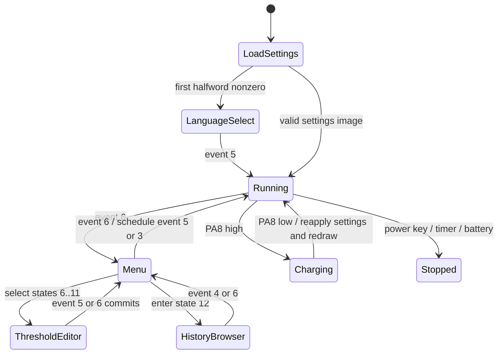

# Application and menu recovery

Evidence: original8ed4/908a, b5c8/b9e0/bc90, a910/aed0/b29e, 11086,
13264,1598c/15af6/164d4/169d4,14a92,7780,c248/c320,c468/c570.
Maintained source: `reconstructed/application/`, `ui/menu.c`, `measurement/thresholds.c`.

In the binary, menu/editor/history/charging loops are blocking. The native state machine suspends
normal packet dispatch in these states but allows deterministic timer/input calls in host tests.
This is a structural refactoring; no cycle-equivalence claim follows.

Normal iteration dispatches view buttons, restores a pending saved event with a16-byte copy
(only13 bytes were refreshed by the ISR), parses unless HOLD, dispatches the view event, suppresses
further handling, polls charging, then handles the battery-due flag outside modes09/13.
USART IDLE disables/rearms DMA, runs the blank-frame predicate and snapshots FD events. It is
not a FIFO. Button interrupts also share a single overwritable event slot. Original blocking
interrupt debounce and long-press timing are preserved in the optional SDK port; ISR/foreground
snapshot races remain a hardware validation item.

## Menu IDs

| IDs | Meaning |
|---|---|
|1 /2..4|view category / Regular, Recording, Monitor|
|5 /6..11|threshold category / V low/high, A low/high, temperature low/high|
|12|history browser|
|13 /14..15|system settings / Chinese, English|
|16..19|holes in the original transition switches|
|20..21 /22|display layouts / brightness|
|23..24|Celsius / Fahrenheit|
|25..28|auto-off disabled /300 /900 /1800 seconds|
|29 /30..31|reset category / cancel, confirm|
|32|about|

The original last auto-off label says20min although the threshold is1800 seconds.
Next and previous transitions are separate32-entry tables in `ui/menu.c`; several endpoints
stay put. Navigation consumes events1/2. Enter3 consumes unless a nested history handler
returns6; BACK4 remains pending in the menu handler. View selection5 leaves5 pending after
returning to state1. Exiting menus schedules event5 in Regular and3 in other views.

## Measurement and alarm policies

Regular event3 cycles0C,0D,0B,0A,0E; event4 cycles11,10,16,15; event1 cycles12,0F,09,13.
Event5 requests14 and cycles its separate12-position selector. Short event2 requests HOLD03
outside09/13. Long event2 toggles a host-side relative reference only in the seven observed modes.
A reference is cleared when the reported mode or unit differs. Autoranging is owned by the peer;
no ADC range/calibration algorithm is inferred from these selectors.

FD03 toggles HOLD; recognized mode events clear HOLD before updating the mode. The full per-view
mode policies are compared against original instructions. Unported resource layouts are explicit
rendering interfaces. The parser retains raw reported units; changing unit flags does not synthesize
an extra mode command.

Threshold settings at20000032..3C are six sign/magnitude halfwords. Current limits use hundredths;
temperature limits use Celsius storage. Column1 toggles sign, columns2/3/4 change100/10/1.
The editor clamps to-999..999 (temperature-55..999) before enforcing strict low<high. Event5 clears
and commits;6 commits but remains pending for the outer menu. Zero commits as8000. Alarm equality
keeps the previous state. Temperature selection also clears settings bit6; it does not recompute
the auto-off threshold variable until the original auto-off/apply path runs.

## Test boundaries

`tools/test_application_differential.py` executes the preserved original integer instruction records,
including shared save/restore blocks. Render/IO boundaries are stubbed and declared per test.
The parser/format/history/threshold tests execute the original software floating-point helpers.
Pixel tests compare ordered coordinates/colors, and NCV tests compare paths, coordinates and delays.
No MMIO, peer ASIC, analog inputs, external resource pixels or physical interrupt timing is emulated.
