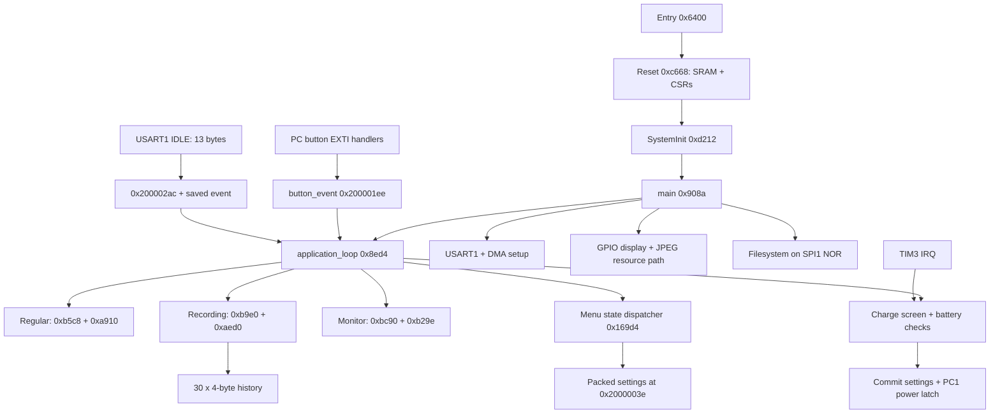

# Recovered application architecture

This is a bare-metal foreground application with interrupt-updated globals. No RTOS scheduler, task context
switching, RTOS API or OS strings have been identified. GCC save/restore helpers are compiler support, not
evidence of an RTOS. Unnamed code still requires review, so absence of evidence is not a formal proof.

The main entry initializes priority grouping, clock bookkeeping, SysTick delays, USART2 debug at 115200,
USART1 measurement at 9600, button EXTI, battery inputs, display, resource filesystem and TIM3.
It then enters a nonreturning foreground loop. A separate strlen at 0x90d2 follows main in flash;
correctly marking the loop nonreturning separates that function from main.

The foreground loop handles a startup two-key condition, dispatches one of three views, processes DMA data,
checks charging state and performs battery/UI updates. Application view is at 0x200001de; measurement mode
is at 0x20000206; these are different state variables. Menu dispatch contains a recovered 32-state switch.
Packet parsing, UI state and command selection are intertwined; the full view logic is retained as pseudocode.

## Buttons and future expansion

PC2 is a power-related input. PC8 produces event 5 or event 6 after 61 repeated 10 ms waits, following a 20 ms
debounce. PC9 produces 3, PC10 produces 1, PC11 produces 2, PC12 produces 4. GPIOC also carries display controls,
the backlight PWM and analog/charge-related signals, so spare-pin assumptions require a board map.
The firmware stores one event byte, not an event queue. Simultaneous interrupts can overwrite events;
PC12 wins within the EXTI15_10 handler's ordered checks. The reconstructed tests preserve this behavior.
Blocking delays occur inside interrupt handlers and must be considered before adding more inputs or recording work.
The separate foreground long-press routine at 0x7b08 uses 10 ms polls with 41/101-count thresholds;
it is not the same policy as the PC8 interrupt handler. TIM3 refresh logic waits until the tick counter
exceeds 20, then adds 20 to the inactivity counter: these are different counts in the original code.
Actual elapsed timing still requires hardware validation.

## History and settings

The persistent RAM buffer starts at 0x20000020. It is loaded as 128 halfwords from 0x08040000.
Settings word is at 0x2000003e; count is at 0x20000040; thirty records begin at 0x20000042.
Each four-byte record contains a 16-bit metadata word and 16-bit magnitude. Append shifts 29 records toward
older positions, writes index zero, and caps count at 30. The recording view event path calls 0x12c78, which
updates its visible row state then appends history; extended automatic logging cadence is not fully recovered.

Metadata bits 0..5 are measurement mode, 6..11 unit ID, bit 12 sign, bits 13..14 decimal scale.
Scale codes 3/2/1/0 divide magnitude by 1000/100/10/1. Packing selects these at absolute values below 10/100/1000;
float-to-integer conversion truncates. Two overload representations store 65535 or 61166. Their exact display
interpretation is retained by the original overload classifier. The C encoder rejects nonfinite/out-of-range
input instead of relying on undefined native float-to-integer conversion; that is an explicit guard.

Shutdown commits the full 256-byte settings/history buffer using internal flash erase/program operations.
The address 0x08040000 is outside the supplied BIN. The subsequent WCH datasheet audit distinguishes
the RC model's 256 KiB zero-wait area from its total 480 KiB Code Flash, so this address is not ruled
out by the nominal 256 KiB figure. Its actual contents, access conditions and flash/RAM partition still
require device evidence; see [dump feasibility](FIRMWARE_DUMP_FEASIBILITY.md). Device-specific calibration
may exist elsewhere or inside the peer; its absence from this image must not be interpreted as dispensability.

## External resources and calibration

The NOR disk adapter reports 2048 sectors x 4096 bytes = 8 MiB, matching the user-provided W25Q64 capacity.
Filesystem paths and JPEG decoding connect this storage to display assets. Disk read/write wrappers mask sector
count to four bits before shifting by 12; requests of 16 sectors therefore cannot be assumed to work normally.
Sector-preserving writes use a 4096-byte scratch buffer and 256-byte page programming.

The display sequence resembles a common 320x240 color LCD family, but no unique controller identification has
been recovered. The firmware's two-key startup path processes measurement packets; calling it calibration mode
is a hypothesis until its commands, UI and peer behavior are fully traced. No fictional calibration API is provided.

## Native application continuation

The current maintained controller is `reconstructed/application/application.c`; the earlier
`foreground.c` remains a smaller dispatch reference. Native resumable states cover normal operation,
menus, six threshold editors, history browsing, initial language selection, charging and shutdown.
Their original blocking-loop evidence and state IDs are documented in
[`application_state_machine.md`](../analysis/application_state_machine.md).

Control/settings changes occur in typed C. IO/renderer gaps retain their original addresses and
are counted if unbound. The largest original menu routine11086 is six threshold editors, now one
parameterized editor with sign/magnitude storage and deterministic tests. The host owns HOLD/relative
and UI policies; it does not own a recovered ASIC range/calibration algorithm. Updated role names
are an overlay, leaving the original439-function evidence unchanged. Per-address full/partial source
coverage and bounded behavioral evidence are tracked separately from naming.
