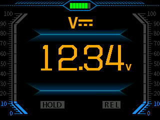
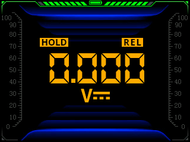
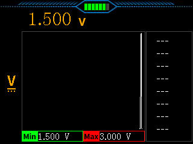
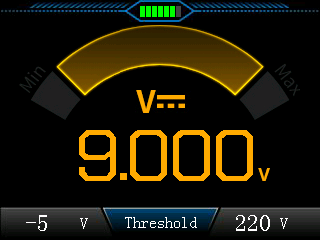
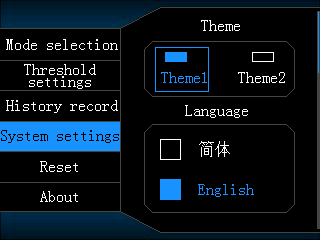
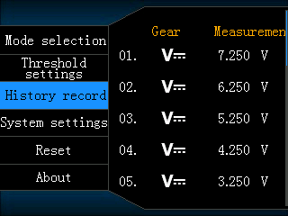
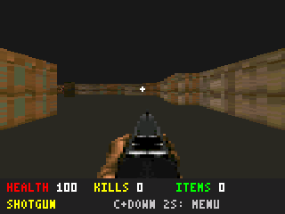
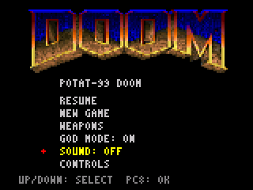
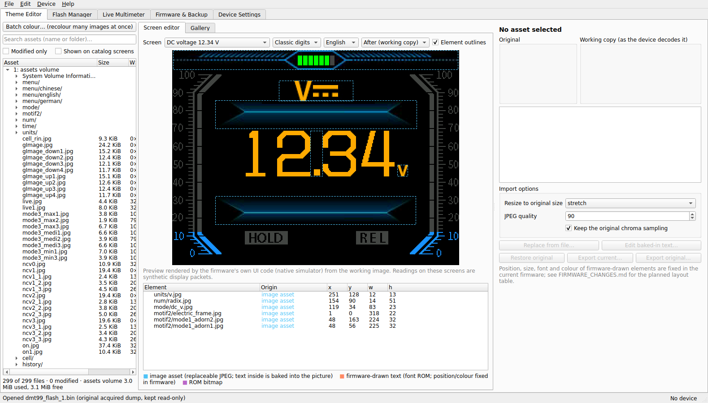
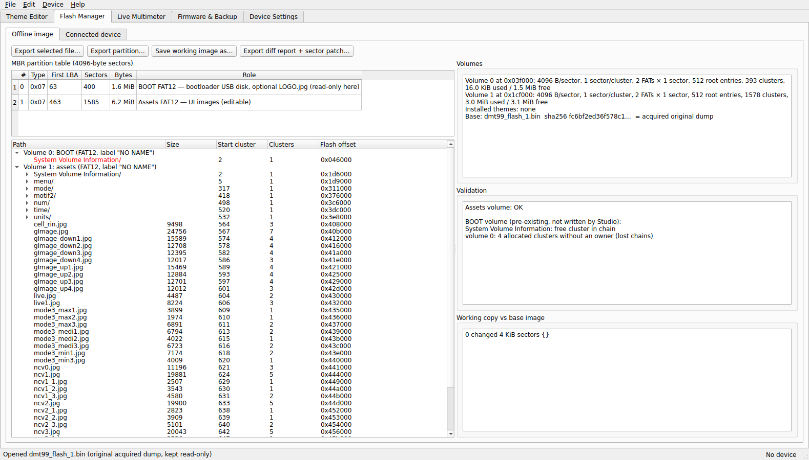

# Ekran galerisi

## POTAT-99 / custom firmware

Mevcut `docs/firmware_screens/` görüntüleri RV32 emülasyonundan alınmıştır;
normal ekranlar için V2.4/parity karşılaştırma kanıtına eşlik eder. Bunlar
0.6.0'ın fiziksel cihaz fotoğrafları veya yeni tema ekranlarının kanıtı değildir.

| Normal ölçüm | İkinci görünüm, HOLD/REL |
|---|---|
|  |  |

| Grafik | Monitor |
|---|---|
|  |  |

| Menü | Geçmiş |
|---|---|
|  |  |

## DOOM 0.4.0

Önceki doğrulanmış 0.4.0 BIN'inin emülatör ekranları yeniden kullanıldı.
Uzun emülatör oturumu çalıştırılmadı. SRAM fixture içeren ileri test ekranları
kendi [ayrıntılı galerisinde](../../projects/doom/docs/screenshots/v0.4.0/README.md) etiketlidir.

| Oyun | Menü / ses |
|---|---|
|  |  |

## Studio tema editörü ve Flash Manager

Aşağıdaki iki görüntü birleştirme sırasında **gerçek Qt uygulamasından**,
offscreen modda ve native C önizleme aracıyla alındı. Donanım bağlanmadı,
canlı ölçüm başlatılmadı. Yeniden üretim: `tools/capture_studio_gallery.py`.

Oyun ve üretici görsellerinin hakları ilgili sahiplerine aittir;
[yeniden dağıtım sınırları](../LEGAL_AND_SAFETY.md) geçerlidir.
