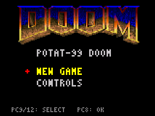
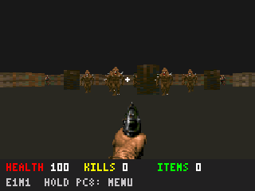
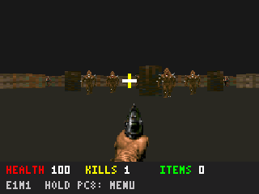
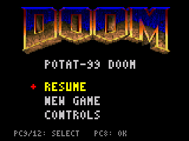

# DMT99 emülatöründe DOOM ekran görüntüleri

18 Ekim 2026: mevcut `dmt_99_analysis/tools/fw_emulator.py` ile gerçek RV32
`dmt99-doom.bin` çalıştırıldı. Bu dosya yayımlanan oyun BIN’iyle byte-identical.
Ekranlar emüle edilen panelin **320×240 framebuffer** çıktısıdır; masaüstü
renderer görüntüsü veya hazırlanmış görsel değildir. 14 tamamlanmış kare,
aynı girdileri alan native C çıktısıyla RGB565 düzeyinde eşleşti.

| Aşama | PNG |
|---|---|
| Açılış menüsü | [01-menu.png](01-menu.png) |
| E1M1 başlangıcı | [02-game.png](02-game.png) |
| Yedi ileri adım | [03-forward.png](03-forward.png) |
| Üç sola dönüş, görünür düşmanlar | [04-enemies.png](04-enemies.png) |
| Ateş | [05-fire.png](05-fire.png) |
| Uzun PC8 ile duraklatma | [06-pause.png](06-pause.png) |

Buton sırası: PC8 kısa → PC9 ×7 → PC10 ×3 → PC8 kısa → PC8 uzun.
Tam GPIO/hold dizisi, BIN/emülatör/kare/PNG hash’leri: [capture.json](capture.json).

Mevcut `tools/test_emulator.py` ayrıca yeniden çalıştırıldı: temiz açılış,
bootloader interrupt artıkları, HSE fallback ve açılışta basılı POWER olmak
üzere dört senaryo geçti. Sonuç: [regression.json](regression.json).

Fault, panel sınır aşımı, ASIC TX ve Flash yazımı görülmedi. Ana proje ve
firmware değiştirilmedi. Bu sonuç fiziksel donanım veya USB yükleme testi değildir.
