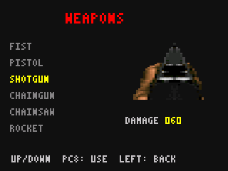
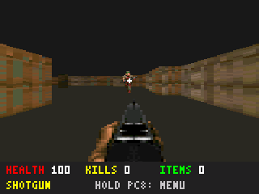
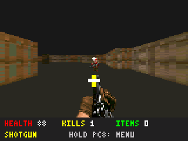

# DOOM0.3.0 — actual BIN screenshots

These images were saved from the panel framebuffer of the actual RV32 BIN
running in the DMT99 emulator, not physical hardware.

enemy-*, corpse-* and wall scenes use controlled SRAM actor fixtures;
production code exposes no test API. Original CPU instructions execute
sight/chase/attack/death/wall behavior. These frames are excluded from native
pixel-equality counts;40 normal GPIO/clock frames matched native C.

GIFs preview PNG sequences; playback speed is not measured hardware FPS.
Lossless PNG hashes: [screenshots.json](screenshots.json).
[Detailed emulator results](../../validation/v0.3.0/emulator_results.json).
