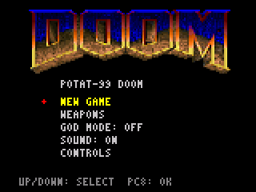
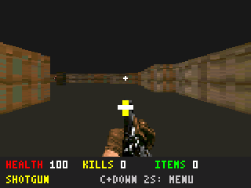
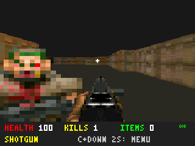
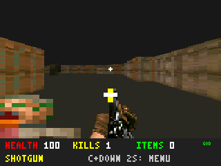

# 0.4.0 emülatör ekranları

Gerçek RV32 BIN çalıştırıldı. Menü/oyun girişleri GPIO PC8/9/10/11/12 üzerinden.
Panel çıktıları PNG kaydedildi; target renderer yerine host çizim çağrısı konmadı.

`held-fire.png`: orta tuş 2,3 saniye tutuldu; ateş sürdü, menü açılmadı.
`pause.png`: yalnız PC8 + aşağı PC10 birlikte 2 saniye tutulunca menü açıldı.

God/duvar/ceset sahneleri kontrollü SRAM actor konumları kullanır. God senaryosunda
önceden saldırısı doğrulanmış insan düşman oyuncuya yakındır; sağlık 100 kalır.
Ses kapalı atışta yeni PWM tonu üretilmedi (görüntüden değil MMIO kaydından kontrol).
`wall-blocks-shot.png` görüş, atış ve silah sesiyle uyanmanın engellendiği sahne;
`corpse-removed.png` sayaç hızlandırılmış silme fixture'ıdır. Gerçek 80 tick süre
C testinde doğrulandı. Bu görüntüler fiziksel cihaz/FPS kanıtı değildir.

PNG hash'leri `screenshots.json`, ayrıntılar [test raporu](../../../TEST_RESULTS.md).
